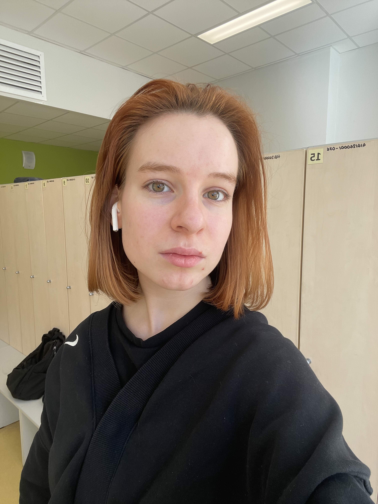

# Kristina Vasilieva

**Sviluppatrice Software Junior | Studentessa di Informatica**

---

## Informazioni di contatto

- **Email:** kristiniviki@icloud.com
- **GitHub:** [Razoom145](https://github.com/Razoom145)
- **Località:** San Pietroburgo, Russia

---

## Profilo personale

Sono una studentessa di Informatica presso l'Università Statale di San Pietroburgo, dove studio Programmazione e Tecnologie dell'Informazione.

Sono appassionata di ingegneria del software, intelligenza artificiale e sviluppo di applicazioni. Mi piace realizzare progetti pratici, esplorare nuove tecnologie e migliorare continuamente le mie competenze di programmazione.

Ho completato diversi corsi online professionali, tra cui Harvard CS50x e il programma IBM Full Stack Software Developer.

I miei principali interessi riguardano attualmente lo sviluppo software, il machine learning, l'intelligenza artificiale e la sicurezza informatica.

Sono una persona motivata e autonoma, con buone capacità di pensiero analitico, attenzione ai dettagli e desiderio di sviluppare prodotti software di alta qualità.

## Formazione

**Università Statale di San Pietroburgo (SPbU)**

- Laurea triennale in Programmazione e Tecnologie dell'Informazione.
- Corso di laurea: 02.03.02 — Informatica Fondamentale e Tecnologie dell'Informazione.
- 2026 – In corso.

### Formazione online

- **Harvard University** — CS50x: Introduzione all'informatica.
- **IBM** — Full Stack Software Developer Professional Certificate.
- **IBM** — Introduction to Software Engineering.

## Competenze tecniche

### Linguaggi di programmazione

- Python
- Java
- C++
- Swift
- JavaScript
- TypeScript
- SQL

### Framework e tecnologie

- SwiftUI
- Next.js
- React
- Tailwind CSS
- Flask
- SQLAlchemy
- PostgreSQL
- Prisma ORM
- Supabase

### Strumenti di sviluppo

- Git
- GitHub
- Xcode
- Visual Studio Code
- Vercel

### Altre competenze

- Programmazione orientata agli oggetti (OOP).
- Progettazione di database.
- Sviluppo di API REST.
- Sviluppo Frontend e Backend.
- Fondamenti di Machine Learning.

## Progetti

### VOC — Applicazione per l'apprendimento del vocabolario

Un'applicazione iOS progettata per aiutare gli utenti ad ampliare il proprio vocabolario inglese attraverso esercizi interattivi e un sistema di ripetizione dilazionata.

**Tecnologie:** Swift, SwiftUI, integrazione con intelligenza artificiale e modelli linguistici (LLM).

**Funzionalità principali:**

- Organizzazione del vocabolario per livelli di conoscenza della lingua (A1–C1).
- Esercizi interattivi per l'apprendimento del lessico.
- Generazione e validazione degli esercizi tramite intelligenza artificiale.
- Esperienza di apprendimento personalizzata.
- Sistema di ripetizione dilazionata.

**Stato:** In sviluppo.

### FinTrack — Applicazione per la gestione delle finanze personali

Un'applicazione web progettata per aiutare gli utenti a gestire le proprie finanze personali, monitorare le spese e organizzare le informazioni finanziarie.

**Tecnologie:** Python, Flask, SQLAlchemy.

**Funzionalità principali:**

- Gestione delle transazioni finanziarie.
- Monitoraggio delle spese.
- Integrazione con database.
- Sviluppo della componente backend dell'applicazione.

### TODO List — Applicazione per la gestione delle attività

Un'applicazione web progettata per aiutare gli utenti a organizzare le attività quotidiane, gestire le proprie attività e monitorare la produttività personale.

**Tecnologie:** Next.js, Tailwind CSS, Prisma ORM, Supabase.

**Funzionalità principali:**

- Creazione e gestione delle attività.
- Organizzazione e monitoraggio delle attività quotidiane.
- Integrazione con il database tramite Supabase.
- Gestione del database con Prisma ORM.
- Interfaccia utente responsive.
- Architettura moderna di un'applicazione web full-stack.

### About-Kris — Sito web personale

Un progetto web personale creato per approfondire lo sviluppo frontend moderno e acquisire esperienza pratica con le tecnologie web.

**Tecnologie:** Next.js, React, Tailwind CSS.

**Funzionalità principali:**

- Interfaccia utente responsive.
- Architettura moderna per applicazioni web.
- Sviluppo basato su componenti.
- Pubblicazione del progetto tramite Vercel.

## Lingue

- **Russo:** Madrelingua.
- **Inglese:** B1 (Livello intermedio).
- **Italiano:** A1 (Livello principiante).

---

*Ultimo aggiornamento: novembre 2026.*
