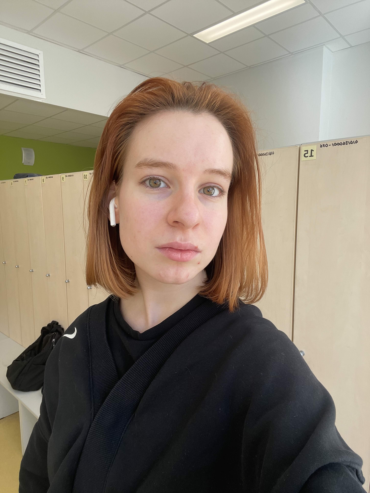

# Кристина Васильева

**Младший разработчик программного обеспечения | Студентка направления «Информатика»**

---

## Контактная информация

- **Email:** kristiniviki@icloud.com
- **GitHub:** [Razoom145](https://github.com/Razoom145)
- **Местоположение:** Санкт-Петербург, Россия

---

## О себе

Я студентка Санкт-Петербургского государственного университета, обучаюсь по направлению «Программирование и информационные технологии».

Увлекаюсь разработкой программного обеспечения, искусственным интеллектом и созданием приложений. Мне нравится работать над практическими проектами, изучать новые технологии и постоянно совершенствовать свои навыки программирования.

Я прошла несколько профессиональных онлайн-курсов, включая Harvard CS50x и программу IBM Full Stack Software Developer.

В настоящее время особенно интересуюсь разработкой программного обеспечения, машинным обучением, искусственным интеллектом и кибербезопасностью.

Я самостоятельная и целеустремлённая, обладаю аналитическим мышлением, вниманием к деталям и стремлением создавать качественные программные продукты.

## Образование

**Санкт-Петербургский государственный университет (СПбГУ)**

- Бакалавриат по направлению «Программирование и информационные технологии».
- Направление подготовки: 02.03.02 — Фундаментальная информатика и информационные технологии.
- 2026 — настоящее время.

### Дополнительное образование

- **Harvard University** — CS50x: Введение в информатику.
- **IBM** — Full Stack Software Developer Professional Certificate.
- **IBM** — Introduction to Software Engineering.

## Технические навыки

### Языки программирования

- Python
- Java
- C++
- Swift
- JavaScript
- TypeScript
- SQL

### Фреймворки и технологии

- SwiftUI
- Next.js
- React
- Tailwind CSS
- Flask
- SQLAlchemy
- PostgreSQL

### Инструменты разработки

- Git
- GitHub
- Xcode
- Visual Studio Code
- Vercel

### Дополнительные навыки

- Объектно-ориентированное программирование (ООП).
- Проектирование баз данных.
- Разработка REST API.
- Frontend- и Backend-разработка.
- Основы машинного обучения.

## Проекты

### VOC — Приложение для изучения иностранной лексики

iOS-приложение, предназначенное для изучения и закрепления английской лексики с помощью интерактивных упражнений и системы интервального повторения.

**Технологии:** Swift, SwiftUI, интеграция ИИ и больших языковых моделей (LLM).

**Основные возможности:**

- Организация слов по уровням владения языком (A1–C1).
- Интерактивные упражнения для изучения лексики.
- Генерация и проверка упражнений с помощью искусственного интеллекта.
- Персонализированный процесс обучения.
- Система интервального повторения.

**Статус:** В разработке.

### FinTrack — Приложение для управления личными финансами

Веб-приложение, предназначенное для управления личными финансами, отслеживания расходов и систематизации финансовой информации.

**Технологии:** Python, Flask, SQLAlchemy.

**Основные возможности:**

- Управление финансовыми транзакциями.
- Учёт и отслеживание расходов.
- Интеграция с базой данных.
- Разработка серверной части приложения.

### TODO List — Приложение для управления задачами

Веб-приложение, предназначенное для организации повседневных дел, управления задачами и отслеживания личной продуктивности.

**Технологии:** Next.js, Tailwind CSS, Prisma, Supabase.

**Основные возможности:**

- Создание и управление задачами.
- Организация и отслеживание повседневных дел.
- Интеграция с базой данных Supabase.
- Работа с базой данных с использованием Prisma ORM.
- Адаптивный пользовательский интерфейс.
- Современная архитектура full-stack веб-приложения.

### About-Kris — Персональный веб-сайт

Персональный веб-проект, созданный для изучения современных технологий frontend-разработки и получения практического опыта в создании веб-приложений.

**Технологии:** Next.js, React, Tailwind CSS.

**Основные возможности:**

- Адаптивный пользовательский интерфейс.
- Использование современной архитектуры веб-приложений.
- Компонентный подход к разработке.
- Развёртывание проекта с использованием Vercel.

## Владение иностранными языками

- **Русский:** родной.
- **Английский:** B1 (средний уровень).
- **Итальянский:** начальный уровень (A1).

---

*Последнее обновление: ноябрь 2026 года.*
